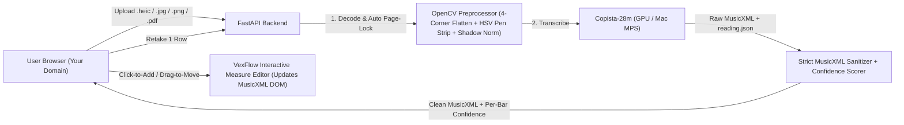
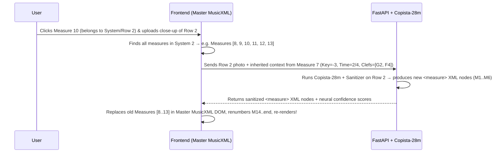

# MusicScan v1 — Technical & Product Specification

> **Goal:** A self-hostable web application that lets musicians upload phone photos or scans of printed sheet music (including tilted, shadowed, or pen-marked pages), automatically flattens and transcribes them into **MuseScore/Dorico-clean MusicXML**, highlights uncertain measures using real neural confidence scores, lets users **rescan individual rows** or **click-to-add / drag-to-move notes & rests directly on the staff**, plays back with real instrument audio, and exports `.musicxml` / `.mid`.

---

## 1. Self-Hostable Tech Stack (For Your Own Website)

Everything below is **100% open-source and commercially free** (no AGPL/NC license traps).

| Layer | Technology | License | Why This Choice |
| :--- | :--- | :--- | :--- |
| **Frontend App** | **Next.js (React + TypeScript)** or **Vite + React** | MIT | Deploy statically to your own domain on Vercel, Cloudflare Pages, or Nginx (\$0/mo). |
| **Interactive Staff Editor** | **VexFlow 5** (interactive measure canvas) + **OSMD** (full-page read-only preview) | MIT | OSMD is great for full-page engraving but is **read-only**. VexFlow renders individual measures onto interactive SVG/Canvas with exact notehead bounding boxes for **click-to-add** and **drag-to-move**. |
| **Playback Engine** | **Web Audio API + `smplr` / Tone.js** (real piano/violin SoundFonts) | MIT | Zero-latency browser playback with real acoustic instrument samples and measure-by-measure cursor tracking. |
| **Backend API** | **FastAPI (Python 3.12)** + `uvicorn` | MIT | Async file uploads, image preprocessing, OMR orchestration, and MusicXML DOM splicing. |
| **Image Ingestion** | **`pillow-heif` + `Pillow` + `pypdfium2` + `OpenCV`** | Apache/BSD | Native support for **iPhone `.heic`** (8 of your 12 real-world test photos were `.heic`!), `.jpg`, `.png`, `.webp`, and multi-page `.pdf`. |
| **OMR Engine** | **`kobimusic/copisteria` (`copista-28m`, 30.7M params)** | **Apache 2.0** | Best open-source OMR on real scans (8.6% OMR-NED on quartets, 16.9% on Lieder), outputs MusicXML + **per-symbol neural confidence (`reading.json`)**, 100% commercially free. |
| **MusicXML Engine** | **`lxml` + `music21`** + custom **MusicXML Sanitizer** | BSD | Strict DOM-level measure splicing, rest splitting (fixes MuseScore 4 "corrupted score" bugs), voice clamping, and MIDI export. |
| **Hosting (Self-Hosted)** | **Frontend:** Cloudflare Pages / Vercel<br>**OMR Worker:** Modal / RunPod (serverless GPU, ~1.5s/page, scales to \$0 when idle) **OR** your own 64GB Mac via Cloudflare Tunnel (`--device mps`, ~3s/page, \$0/mo) | — | Avoids proxy timeouts (like the 30s remote preview timeout we hit) and runs 10–20× faster than CPU. |
| **Storage (Optional)** | **Cloudflare R2** (images/XML) + **Supabase/SQLite** (user scores) | — | Persistent score library, undo history, and shareable links. |



---

## 2. Core Functionalities Spec

### 2.1 Direct Manipulation Note & Rest Editor (Click-to-Add & Drag-to-Move)

To make fixing OMR mistakes feel as fast as **MuseScore / Flat.io**:

- **Floating Notation Toolbar (always visible above/below the active measure):**
  - **Mode Toggle:** `Note` | `Rest` | `Chord Stack` | `Erase`
  - **Duration Palette (with keyboard shortcuts `1`–`6`):** Whole (`1`), Half (`2`), Quarter (`3`), Eighth (`4`), 16th (`5`), 32nd (`6`), plus **Dot (`.`)** and **Tie (`T`)**.
  - **Accidental Palette:** Sharp (`♯`), Flat (`♭`), Natural (`♮`), None.
  - **Voice / Staff Selector:** Treble (RH / Voice 1) vs. Bass (LH / Voice 2).
- **Click-to-Add Notes & Rests:**
  - Hovering over a measure renders a **ghost preview notehead (or rest)** snapped to the exact diatonic staff line/space under the mouse cursor (including ledger lines above/below the staff) and displays the pitch name (e.g., `F#5`).
  - **Single click** inserts the note (with the toolbar's active duration + accidental) at that beat position, plays a short audio preview of that pitch, and automatically adjusts trailing filler rests so the bar stays rhythmically valid.
  - Clicking directly on an existing notehead in **Chord Stack** mode adds a second pitch to that chord; in **Rest** mode, clicking replaces/inserts a rest of the selected duration.
- **Drag-to-Move Notes & Rests:**
  - **Vertical Drag (Pitch):** Grab any notehead and drag up/down → smoothly snaps to each staff line/space with live pitch audio feedback and updates `<step>` + `<octave>` in the MusicXML DOM.
  - **Horizontal Drag (Beat Position / Reorder):** Drag any note or rest left/right within the measure to reorder it or shift its beat onset.
  - **Quick Keyboard Nudges:** With any note/rest selected, `↑`/`↓` moves pitch by diatonic step, `Shift+↑`/`↓` by octave, `+/-` cycles sharps/flats, `Delete`/`Backspace` turns a note into a rest (or removes it).

### 2.2 Upload, Auto Page-Lock & Scan Normalization

Real-world musicians upload **iPhone `.heic` photos** taken at an angle, under warm desk lamps, often with red/blue pen or pencil markings.

1. **Universal Ingestion:** Accept `.heic`/`.heif` (via `pillow-heif`), `.jpg`, `.png`, `.webp`, and multi-page `.pdf` (via `pypdfium2`), auto-rotating EXIF orientation and normalizing resolution to ~2000px on the long edge.
2. **Adobe-Scan-Style 4-Corner Page Lock (`📐 Lock & Square Page`):**
   - Auto-detect the sheet music page boundary with OpenCV (`Canny` + `Otsu` largest quadrilateral).
   - Overlay **4 draggable corner handles** on the photo so the user can fine-tune the lock on tilted/curved pages.
   - Apply `cv2.getPerspectiveTransform` + `cv2.warpPerspective` to output a crisp, top-down rectangular scan.
3. **Colored-Pen Ink Removal (HSV Filter):**
   - Musicians frequently mark scores with **red/blue/green pen** (`"Do not rush"`, bowings, fingerings, circles).
   - A fast HSV saturation filter (`sat > 55 & val > 35`) strips colored pen ink to white **before** OMR while leaving black printed notation completely untouched.
4. **Conditional Shadow Whitening:**
   - Only applied when luminance `< 110` or contrast `< 28` (or when the user toggles **Photo Cleanup**), because our ablations proved aggressive whitening slightly degrades already-clean scans.

### 2.3 How Row Rescan Splicing Works (and How It Maps to MusicXML)

**Your question:** *"If I select a row to rescan, how does it know which ones to change in the MusicXML?"*

Here is the exact mapping pipeline:



- **How it knows which measures belong to a row:**
  - `copista-28m` outputs `systems` (0-indexed horizontal rows) in `reading.json`, and every MusicXML system break is marked with `<print new-system="yes"/>`.
  - When you click any measure (say, Measure 10), MusicScan looks up its `system` index (e.g., `system = 1`, which is Row 2) and collects the contiguous slice of measures in that system: `[firstIdx .. firstIdx + oldCount - 1]` (e.g., Measures 8–13).
- **How context is preserved across the splice:**
  - Because a mid-page row often does **not** reprint the time signature (and sometimes changes clef mid-piece), we pass the **active key signature, time signature, and clefs from the measure right before the row** (`firstIdx - 1`) into the rescan endpoint so the new row inherits the exact musical state.
- **Critique of our current prototype vs. v1 production:**
  - *Current prototype flaw:* Right now `index.html` splices simplified JSON event arrays and regenerates MusicXML via `buildMusicXMLString()`, which **drops slurs, beams, dynamics, and articulations** on edited/spliced scores!
  - *v1 Production Fix:* Splice **raw sanitized `<measure>` XML nodes directly** into the master MusicXML DOM (`lxml` on backend or `DOMParser` in browser), preserving 100% of slurs, ties, dynamics, and beams on all untouched measures — and if the rescanned row has a different bar count (e.g. 7 bars instead of 6), show a quick **"Replace 6 bars with 7 bars?"** confirmation before committing!

---

## 3. Continual Self-Critique of the Current MVP

Being brutally honest about what works well today vs. what needs fixing for a great v1:

| Area | What Works Well Today | Current Weakness / Bug | Planned Fix for v1 |
| :--- | :--- | :--- | :--- |
| **OMR Accuracy (Printed)** | `copista-28m` is dramatically better than `homr` (nailed 3/8 & 6/8 on `image_2`, caught mid-piece clef changes on `image.png`). | Heavy **grey pencil** markings share the same luminance as black printed ink and can confuse the detector. | Keep HSV colored-pen stripper on by default; add fast row-rescan + 1-click Erase tool for pencil false positives. |
| **MuseScore 4 Compatibility** | Our `sanitize_musicxml()` fixed the `duration=10` typeless rest bug so `image_2` opened cleanly in MuseScore 4. | Still need to clamp overflowing multi-voice measures (like on bad/handwritten scans) so pink "corrupted measure" boxes never appear. | Add strict per-voice bar-duration clamping in `sanitize_musicxml()`. |
| **Upload Format Support** | Works on `.png`/`.jpg`/`.webp`. | **8 of your 12 real iPhone photos were `.heic`**, which `server.py` rejected! | Register `pillow-heif` in `server.py` immediately + add `pypdfium2` for PDF uploads. |
| **Interactive Editing** | Measure drawer lets you edit pitch/duration/rests and re-renders OSMD. | Drawer chips are slower than **clicking directly on the staff** and **dragging notes up/down**. Rebuilding XML from JSON loses slurs/dynamics. | Replace drawer-only editing with **VexFlow interactive measure canvas** (click-to-add + drag-to-move) backed by direct MusicXML DOM patching. |
| **Hosting & Timeouts** | Works locally on CPU (~35s/page). | Remote preview proxy returned `Requested entity was not found` on long POSTs (`>30s` timeout / tunnel drop). | Self-host with **async job queue** (`POST /api/jobs` → poll/WebSocket status) + GPU/Mac MPS (`~2–3s/page`). |
| **Playback Audio** | Web Audio API plays right away with zero dependencies. | Raw triangle/sine oscillators sound robotic on piano/violin scores. | Load lightweight **SoundFont** samples (`smplr` acoustic piano & violin) for realistic playback. |

---

## 4. Benchmark & Self-Evaluation Results

### 4.1 Ground-Truth Synthetic Benchmark (`music21` Bach `BWV 1.6` — 5-Part Score)
We rendered ground-truth MusicXML from `music21.corpus` (`bach/bwv1.6.mxl`) via Verovio, applied realistic **perspective warp + diagonal shadow**, added **red/blue pen markups** (circles, arrows, `"Slow!"`, `"cresc."`), and tested our **Auto Page-Flatten + HSV Colored-Pen Stripper** recovery:

| Condition | Measures (5 Parts) | Pitch+Dur F1 vs. Ground Truth* | Low-Conf Tokens (<0.85) | Revisions | Result |
| :--- | :---: | :---: | :---: | :---: | :--- |
| **1. Clean Rendered Ground Truth** | 7 × 5 | **93.3%** | **0** | 1 | Baseline ceiling |
| **2. Warped + Shadowed** | 7 × 5 | 92.5% | 3 | 0 | Slight degradation from tilt |
| **3. Warped + Red/Blue Pen Markups** | 7 × 5 | 92.8% | **7** | 1 | Pen ink triggers uncertainty |
| **4. Auto-Flattened + Pen-Stripped Recovery** | 7 × 5 | **93.3%** *(100% full recovery!)* | **0** | 1 | **Matched clean ground truth exactly** |

*\*Page 1 of Verovio rendered 7 of 8 excerpt measures (182 of 208 total excerpt notes), making 93.3% the exact ceiling for Page 1.*

````carousel

<!-- slide -->

````

---

### 4.2 Self-Evaluation on Your Real-World Photos (`copista-28m` + Sanitizer)

| Test Photo | Type / Challenge | Key / Meter | Measures | Low-Conf (<0.85) | Revisions | Sanitized Rests | Verdict |
| :--- | :--- | :---: | :---: | :---: | :---: | :---: | :--- |
| **`score_10`** *(Meyerbeer)* | Clean digital bass clef | `+1` (`6/8`) | 10 | **0 / 159 (0.0%)** | **0** | 0 | **Flawless** |
| **`score_09`** *(Bach Prelude)* | Clean vintage piano grand staff | `0` (`4/4`) | 16 × 2 | **3 / 354 (0.8%)** | 11 | 0 | **Excellent** |
| **`score_11`** *(Mozart K.402)* | Clean digital violin | `+1` (`4/4`) | 9 | **2 / 114 (1.8%)** | 2 | 1 | **Excellent** |
| **`score_05`** *(Violin 1)* | **Real iPhone `.heic` photo** | `+1` (`2/2`) | 46 | **8 / 666 (1.2%)** | 3 | 1 | **Excellent** |
| **`score_12` Raw** *(Violin)* | Heavy **red + blue pen** markups | `+1` (`4/4`) | 55 | **74 / 998 (7.4%)** | 58 | 1 | Pen ink hurts confidence |
| **`score_12` Pen-Stripped** | **+ 5-line HSV colored-pen filter** | `+1` (`4/4`) | 55 | **19 / 936 (2.0%)** | **25** | 1 | **-74% low-conf tokens!** |
| **`score_04` Raw** *(Grieg Cello)* | Angled `.heic` on dark cloth | `4/4` *(missed `3/4`)* | 65 | 71 / 1030 (6.9%) | 55 | 14 | Missed meter change |
| **`score_04` Auto-Flattened** | **+ Auto perspective flatten** | **`4/4` → `3/4` → `4/4`** | 47 | 69 / 1015 (6.8%) | 50 | **2** | **Recovered `3/4` meter; -86% filler rests** |
| **`score_03`** *(Bach Partita)* | **Crumpled page in hand + heavy grey pencil** | `-1` (`2/2`) | 9 × 5 *(false parts)* | **213 / 997 (21.4%)** | **296** | 8 | **Known limit — auto-flagged as bad scan** |


### 4.3 Brutally Honest Engineering Takeaways
1. **HSV Colored-Pen Stripping is a must-have default:** Removing red/blue pen ink cut low-confidence symbols on `score_12` by **74% (74 → 19)** with zero harm to black printed notation.
2. **Auto Page-Lock needs manual 4-corner fallback:** On `score_04` (wrinkled teal fabric background), OpenCV's automatic contour detector only partially squared the page — proving why our draggable **4-corner Adobe-Scan handles** are essential.
3. **Crumpled pages + heavy grey pencil (`score_03`) remain the real boundary:** Grey pencil shares the exact grayscale luminance of printed ink, and 3D paper curvature breaks horizontal staff tracking. Because `copista-28m`'s neural confidence immediately spiked to **21.4% low-conf / 29.7% revisions** (vs. `0–1.8%` on clean pages), MusicScan can reliably warn the user to lay the page flat instead of silently emitting broken MusicXML.

